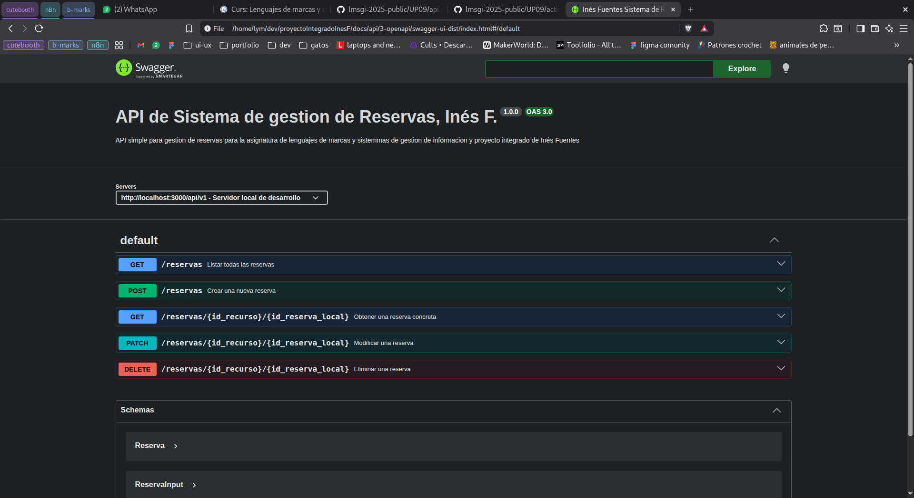
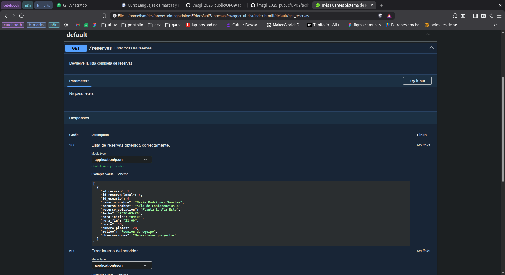
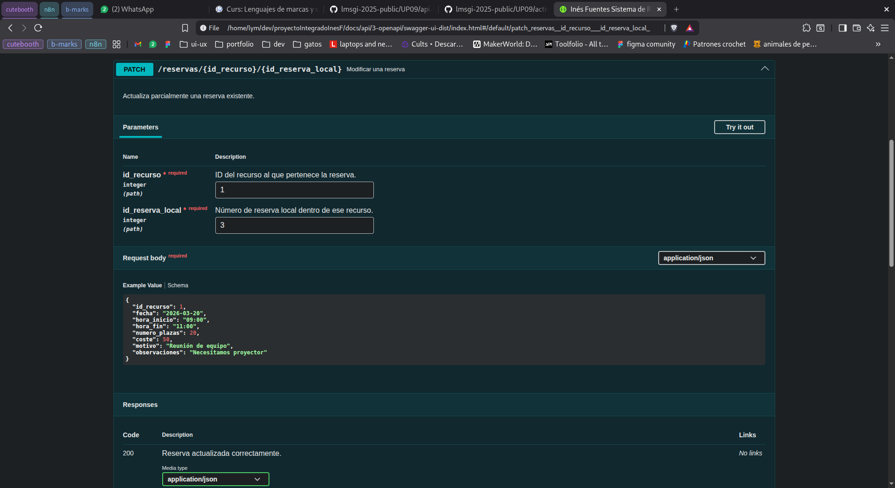
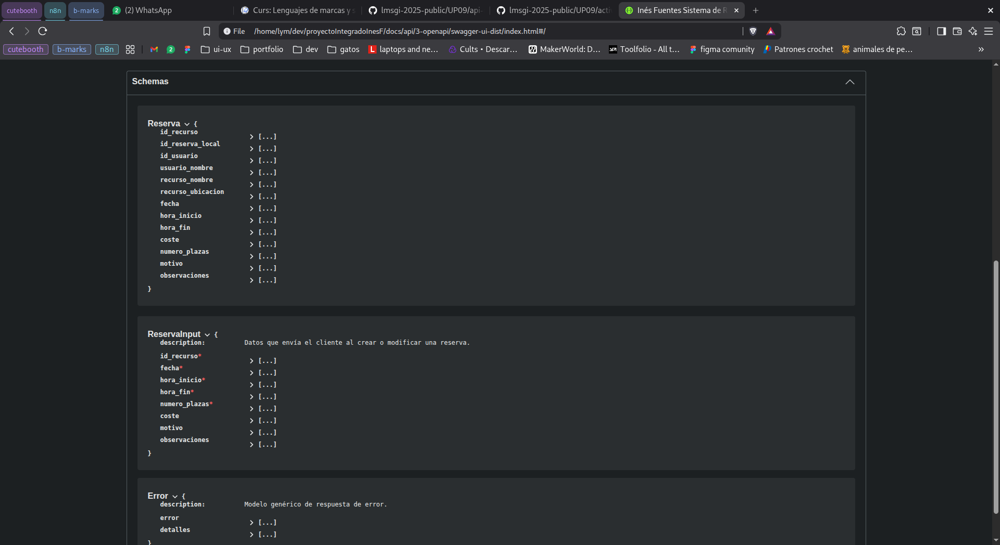
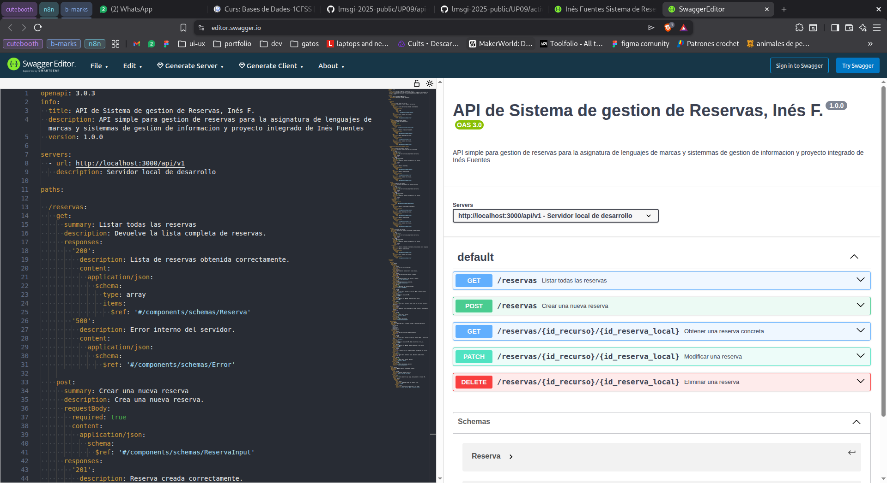

# ANÁLISIS DEL DOMINIO - SISTEMA DE RESERVAS DE RECURSOS

## Comentario previo

Para este ejercicio estoy usando la base de datos que cree con el script de cracion de la base de datos que hice en la asignatura de BD, no es nada especializado, es decir cuando lo hice se me comento que tenia que ser lo mas generico posible porque el tema de proyecto se elegia en segundo y que este año todo tenia que ser generico, preparando todo para el año que viene pero sin espacializarlo demasiado, asi que todos los puntos se tratan de forma generica y no personalizado con la tematica de mi proyecto, ya que cuando fui a elegir una se me dijo que no la eligiera aun, por esto mismo uso palabras ambiguas y no concretas como Recurso, lo menciono por si acaso.(El script se entrego para proyecto intermodular en 'UP5: Entrega BD - Diseño físico. El modelo físico en SQL.' y ademas esta en este repositorio en la carpeta de database/scripts)


## 1. Tablas de la base de datos que usaré

Para el CRUD de reservas necesito estas tablas:

- `RESERVA` (principal)
- `RECURSO` (relacionada por FK — necesito nombre, ubicación y capacidad del recurso)
- `USUARIONORMAL` (relacionada por FK — necesito saber quién hace la reserva)
- `USUARIO` (relacionada con `USUARIONORMAL` — de aquí obtengo nombre y correo del usuario)
- `HORARIO` y `DISPONIBLEEN` (para validar que el recurso esté disponible en el horario solicitado)

## 2. Campos de la tabla `RESERVA` y mapeo a la API

| Campo              | Tipo          | ¿En API? | Razón                                                       |
|--------------------|---------------|----------|-------------------------------------------------------------|
| id_recurso         | INT (FK, PK)  | SÍ       | Identifica qué recurso se reserva                           |
| id_reserva_local   | INT (PK)      | SÍ       | Identificador de la reserva dentro de ese recurso           |
| id_usuario         | INT (FK)      | SÍ       | Saber de quién es la reserva (en respuestas)                |
| fecha              | DATE          | SÍ       | Fecha de la reserva                                         |
| hora_inicio        | TIME          | SÍ       | A qué hora empieza                                          |
| hora_fin           | TIME          | SÍ       | A qué hora termina                                          |
| coste              | DECIMAL(10,2) | SÍ       | Coste de la reserva (puede ser nulo)                        |
| numero_plazas      | INT           | SÍ       | Cuántas plazas se reservan                                  |
| motivo             | TEXT          | SÍ       | Razón de la reserva                                         |
| observaciones      | TEXT          | SÍ       | Notas adicionales (opcional)                                |

**Campos auto-generados por el backend:**

- `id_usuario`: Se obtendrá del token JWT del usuario autenticado; el cliente no lo envía.
- `id_reserva_local`: Lo asignará el backend automáticamente. Como la clave primaria de `RESERVA` es compuesta `(id_recurso, id_reserva_local)`, el backend calculará el siguiente número disponible para ese recurso concreto.


**Información adicional que incluiré (JOINs):**

En las respuestas de la API enriqueceré la reserva con datos de tablas relacionadas para facilitar la lectura:

- `recurso_nombre`: Nombre del recurso (JOIN con `RECURSO`) — para mostrar "Sala de Conferencias A" en lugar de solo el ID.
- `recurso_ubicacion`: Ubicación del recurso (JOIN con `RECURSO`).
- `usuario_nombre`: Nombre del usuario (JOIN con `USUARIONORMAL` → `USUARIO`).

## 3. Validaciones y reglas de negocio

Al crear o modificar reservas validaré:

**Campos obligatorios:**

- `id_recurso`, `fecha`, `hora_inicio`, `hora_fin`, `numero_plazas`

**Lógica:**

- `hora_inicio` < `hora_fin` (CHECK ya existente en la BBDD, pero se valida también en backend)
- `fecha` >= HOY (no permitir reservas en fechas pasadas)
- `numero_plazas` >= 1
- `numero_plazas` <= capacidad del recurso (consultando tabla `RECURSO`)
- El recurso debe estar disponible en ese día de la semana y franja horaria (consultando `DISPONIBLEEN` y `HORARIO`)
- No puede haber solapamiento de horarios: no puede existir otra reserva del mismo recurso en la misma fecha con horas que se crucen
- `id_recurso` debe existir en la tabla `RECURSO`
- `id_usuario` debe corresponder a un usuario de tipo Normal (tabla `USUARIONORMAL`)

**Campos opcionales:**

- `coste`: Puede ser nulo (por ejemplo, para recursos gratuitos)
- `motivo`: Descripción libre de la razón de la reserva
- `observaciones`: Notas adicionales

## 4. Ejemplos de JSON

**REQUEST** (crear reserva):

El cliente envía solo los datos que le corresponden; el backend completa el resto:

```json
{
  "id_recurso": 1,
  "fecha": "2026-03-15",
  "hora_inicio": "09:00",
  "hora_fin": "11:00",
  "numero_plazas": 20,
  "motivo": "Reunión de equipo",
  "observaciones": "Necesitamos proyector",
  "coste": 50.00
}
```

**RESPONSE** (reserva creada):

La respuesta incluye los campos generados por el backend y la información enriquecida:

```json
{
  "id_recurso": 1,
  "id_reserva_local": 3,
  "id_usuario": 6,
  "usuario_nombre": "María Rodríguez Sánchez",
  "recurso_nombre": "Sala de Conferencias A",
  "recurso_ubicacion": "Planta 1, Ala Este",
  "fecha": "2026-03-15",
  "hora_inicio": "09:00",
  "hora_fin": "11:00",
  "coste": 50.00,
  "numero_plazas": 20,
  "motivo": "Reunión de equipo",
  "observaciones": "Necesitamos proyector"
}
```

## Conclusión

Necesito 10 campos de la tabla `RESERVA` y los expongo todos en la API.
Enriquezco las respuestas con 3 campos adicionales provenientes de JOINs (`recurso_nombre`, `recurso_ubicacion`, `usuario_nombre`).
Aplicaré 7 validaciones principales para garantizar la integridad de los datos.(Las podemos ver especificadas en el apartado 3)
El MVP permitirá crear, listar, modificar y eliminar reservas de recursos.


## Imagenes documentacion Swagger UI

Añado al final capturas demostrando que funciona como se pide en el paso2 de validacion y exportación interactiva









